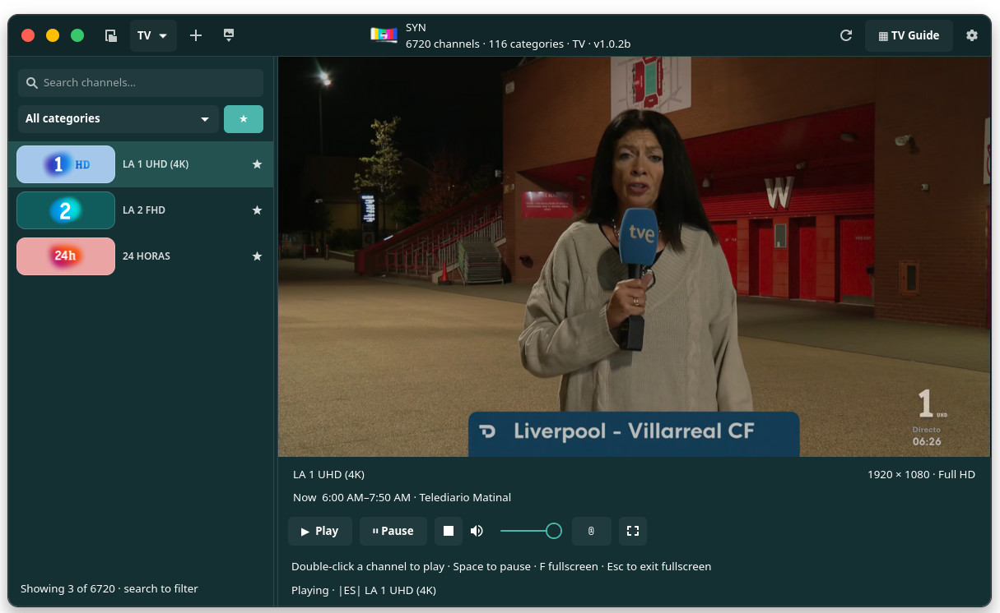
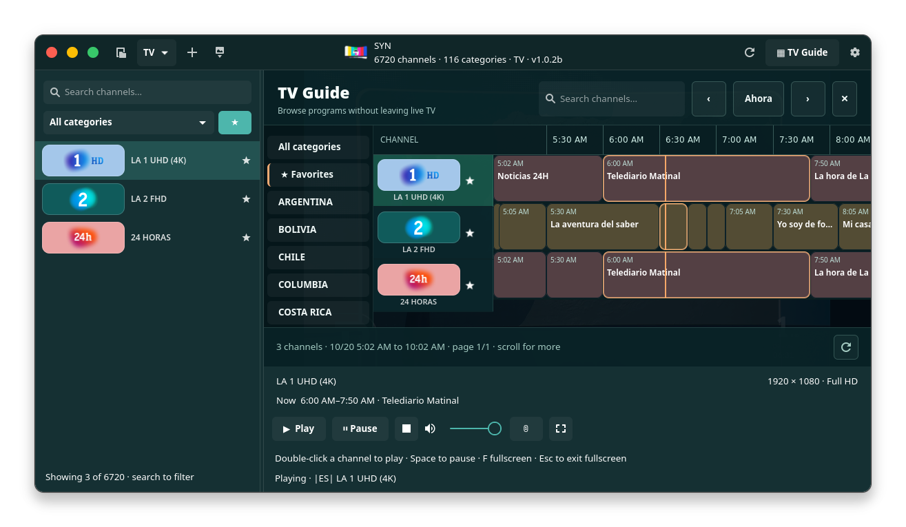
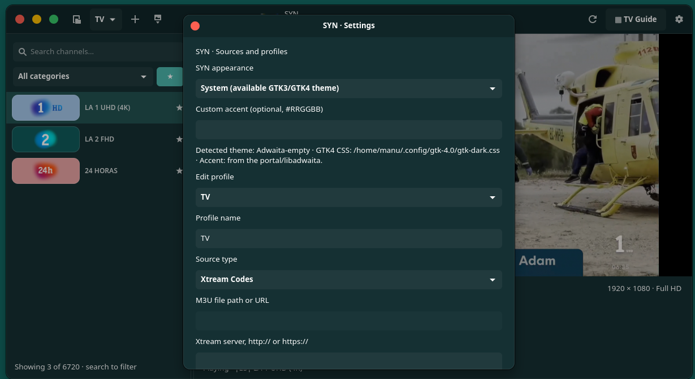

# SYN · IPTV, Cinema & DVR for Linux

<p align="center">
  
</p>

<p align="center">
  <strong>Your TV, films, series, programme guide and recordings — in one GTK4 desktop app.</strong><br>
  <em>Tu televisión, películas, series, guía y grabaciones — en una sola aplicación para Linux.</em>
</p>

<p align="center">
  <a href="https://github.com/manupernas/SYN/releases">Download / Descargar</a> ·
  <a href="https://github.com/manupernas/SYN/actions">Builds</a> ·
  <a href="https://github.com/manupernas/SYN/issues">Issues</a> ·
  <a href="docs/RELEASE_1.3.5.md">What's new in 1.3.5</a>
</p>

**SYN 1.3.5** is a desktop IPTV player for Linux, written in Python with **GTK4, libadwaita and libmpv**, with an independent FFmpeg DVR, an interactive XMLTV EPG and a **TV · SERIES · CINEMA** library. It plays content from your own authorised **M3U** playlists and **Xtream-compatible** accounts. It never supplies channels or subscriptions.

The new interface includes the original SYN colour-bars icon and light/dark-aware wordmark. It offers **System, Light, Dark and SYN Teal** themes, with optional custom accent colours. SYN starts on **live TV**, not the library landing page.

> [!IMPORTANT]
> **Bring your own legal IPTV sources.** SYN does not include playlists, credentials, channels or media. Films, series, artwork and EPG depend on what **your provider actually supplies**. SYN is distributed through GitHub Releases and **is not currently listed on Flathub**.

## At a glance

| TV & EPG | Films & Series | Recordings & Cast |
| --- | --- | --- |
| Live channel browser, per-profile favourites, category search, guide timeline and fullscreen playback | Dedicated **PERFIL → CINE / SERIES** library, searchable cover grids, series/season/episode navigation | Instant and scheduled **DVR** recordings, background worker, timeshift, PNG captures and Chromecast |

### Television

- **Live TV with libmpv:** embedded player, fullscreen, zapping and channel information without launching another application.
- **Multiple profiles:** switch between M3U files, remote M3U playlists and Xtream-compatible accounts.
- **Channels and favourites:** categories, search, channel logos, heart toggles and drag-and-drop favourite ordering, including the EPG and fullscreen channel selector.
- **Interactive EPG:** XMLTV/XMLTV.gz sources, programme details, timeline scrolling and navigation. Schedule a recording directly from a programme's context menu where EPG information is available.
- **Stream controls:** source/API User-Agent separate from playback, automatic reconnection, volume, screenshots and timeshift on compatible streams.

### New in 1.3.5: films, series and your library

Click **◎ PERFIL** to open the TV / SERIES / CINE selection. Normal startup still opens TV.

- **Cinema:** dedicated searchable film grid with poster art, titles and provider categories.
- **Series:** dedicated series grid and an episode browser with seasons/episodes for compatible Xtream catalogues.
- **Xtream catalogues:** SYN requests the provider's VOD and series APIs (`get_vod_streams`, `get_series`, `get_series_info`) **only when supported**.
- **M3U discovery:** entries clearly labelled as films or series by their groups/paths can appear in the corresponding library. Recognisable episode labels (for example `S01E01` or `1x02`) may be grouped under the same series. Other entries remain in TV to avoid misclassifying channels.
- **Resilient covers:** uses images supplied by the provider, caches them independently of TV logos, and displays original typographic/abstract artwork when no poster is available.
- **Designed for large libraries:** initial batches of cards, search and **Show more** help keep the interface responsive.

> **Provider compatibility:** VOD/series features are conditional; a TV-only M3U or Xtream subscription will not magically gain a film or series catalogue. Not all playlist naming conventions can be classified automatically.

### DVR, Chromecast and desktop integration

- **Record now:** the red REC button starts a separate FFmpeg capture, generally stream-copying (`-c copy`) without video re-encoding when possible.
- **Scheduled recording:** use the DVR planner (date/time/channel) or an available EPG programme; view and open recorded files from within SYN.
- **Background DVR:** the independent `syn-dvr-worker` is started/configured automatically on compatible `systemd --user` sessions and can continue after closing the window. It is **not** tied to the system tray.
- **Chromecast:** discover reachable devices and send streams using SYN's bundled Cast bridge, with 720p/1080p transcoding profiles where needed. The Flatpak bundles its Cast Python dependencies and FFmpeg encoder; native packages declare required dependencies.
- **No system tray icon:** `syn-dvr-tray` was removed in 1.3.5. The REC status remains inside the application.
- **Custom appearance:** adaptive System/Light/Dark/Teal themes, user accent colour, original icon, light/dark wordmark, channel logos, English (US/UK) and Spanish locale handling.

**Plug & play means:** install **one** matching package, launch SYN, add your source and use it. No separate Cast or DVR installation scripts are required on supported desktops. A working internet/LAN connection, provider account/playlist, compatible codecs and (for persistent background jobs) an active systemd user session are still needed. Some distributions, firewalls, VMs or Chromecast devices may require normal network configuration.

## Screenshots

<table>
  <tr>
    <th>TV and channels</th><th>EPG</th><th>Settings</th>
  </tr>
  <tr>
    <td><a href="docs/screenshots/01-player-en.png"></a></td>
    <td><a href="docs/screenshots/02-guide-en.png"></a></td>
    <td><a href="docs/screenshots/03-settings-en.png"></a></td>
  </tr>
</table>

*Screenshots may show an earlier UI. The film and series libraries are new in 1.3.5.*

## Download: choose the right package

Get the **1.3.5** release assets from **[GitHub Releases](https://github.com/manupernas/SYN/releases)**. The project builds eight packages: four formats × two CPU architectures.

| Your Linux system | File extension | Architecture label | Installer |
| --- | --- | --- | --- |
| Fedora | `.rpm` | `x86_64` or `aarch64` | DNF |
| Ubuntu / Debian | `.deb` | `amd64` (Intel/AMD) or `arm64` (ARM) | APT |
| Arch / EndeavourOS | `.pkg.tar.zst` | `x86_64` or `aarch64` | Pacman |
| Other distributions / sandboxed | `.flatpak` | `x86_64` or `aarch64` | Flatpak |

**Architecture check:** run `uname -m`. `x86_64` means Intel/AMD 64-bit. `aarch64` means ARM64; Debian package names call that `arm64` and Intel/AMD `amd64`. **Never install an ARM package on x86_64 or vice versa.**

### Fedora (RPM)

Download the file matching your architecture, e.g. `syn-iptv-1.3.5-1.aarch64.rpm`, open a terminal in the Downloads directory and run:

```bash
sudo dnf install ./syn-iptv-1.3.5-1.*.rpm
```

DNF resolves package dependencies. Start **SYN** from the app launcher or run `syn`.

### Debian / Ubuntu (DEB)

Download the matching `amd64` or `arm64` DEB, then:

```bash
sudo apt install ./syn-iptv_1.3.5-1_*.deb
```

APT resolves dependencies. Start **SYN** from the app launcher or run `syn`. Required runtime libraries must be available in your distribution's repositories.

### Arch Linux / EndeavourOS (Pacman)

Download the matching `x86_64` or `aarch64` package, then:

```bash
sudo pacman -U ./syn-iptv-1.3.5-1-*.pkg.tar.zst
```

Pacman resolves packages available in your configured repositories. Start **SYN** from the app launcher or run `syn`. Some ARM-specific distributions may need equivalent dependencies in their own repositories.

### Flatpak (Fedora, Debian, Arch and others)

1. Install **Flatpak** from your distribution's package manager if you don't already have it.
2. Download `SYN-1.3.5-x86_64.flatpak` or `SYN-1.3.5-aarch64.flatpak`, matching `uname -m`.
3. Install the bundle and start SYN:

```bash
flatpak install --user ./SYN-1.3.5-*.flatpak
flatpak run com.mrseivane.Syn
```

If the GNOME runtime is missing, Flatpak can offer to install it (an internet connection and a configured runtime remote may be required). **This is a GitHub bundle, not a Flathub listing.** Flatpak app ID: `com.mrseivane.Syn`.

**Already installed system-wide?** To update that installation instead of creating a second user copy, use:

```bash
sudo flatpak install --system --reinstall ./SYN-1.3.5-*.flatpak
flatpak run --system --branch=master com.mrseivane.Syn
```

**Avoid duplicate installations:** do not install both `--user` and `--system` unless you intentionally need separate copies; the default launcher may otherwise select the wrong one. Check using `flatpak list --app --columns=application,branch,installation`.

<details>
<summary><strong>Instalación rápida en español</strong></summary>

Descarga el archivo de **SYN 1.3.5** para tu distribución y procesador desde [Releases](https://github.com/manupernas/SYN/releases). Comprueba `uname -m`: `x86_64` es Intel/AMD y `aarch64` es ARM64 (en DEB aparece como `arm64`). Ejecuta **solo uno** de estos comandos desde la carpeta donde esté el archivo descargado:

```bash
# Fedora
sudo dnf install ./syn-iptv-1.3.5-1.*.rpm

# Debian / Ubuntu
sudo apt install ./syn-iptv_1.3.5-1_*.deb

# Arch / EndeavourOS
sudo pacman -U ./syn-iptv-1.3.5-1-*.pkg.tar.zst

# Flatpak — instalación de usuario
flatpak install --user ./SYN-1.3.5-*.flatpak
flatpak run com.mrseivane.Syn
```

**Plug & play:** al abrir SYN, añade tu perfil M3U o Xtream. No hace falta ejecutar ningún script adicional para el DVR ni para Chromecast; los servicios se preparan automáticamente en escritorios compatibles. Los catálogos CINE y SERIES aparecen únicamente si tu proveedor los ofrece. Las grabaciones en segundo plano requieren que el sistema siga encendido y una sesión de usuario adecuada.

</details>

## Services, recording safety and limitations

The independent background services are **`syn-dvr-worker.service`** (recordings) and **`syn-cast-bridge.service`** (Chromecast). There is **no `syn-dvr-tray.service`** in 1.3.5. SYN prepares/manages the needed services when it starts, without restarting an already active recording.

```bash
systemctl --user status syn-dvr-worker.service syn-cast-bridge.service
```

On Linux systems without `systemd --user` or with restricted Flatpak portals, the background service may be unavailable; TV playback can still work. Closing a window is not the same as logging out: logout, suspend, shutdown, unstable network connections and IPTV provider connection limits can interrupt a capture. Chromecast discovery usually needs direct LAN access; bridged/isolated VMs can block multicast discovery.

## Build from source (developers)

```bash
git clone https://github.com/manupernas/SYN.git
cd SYN
python3 -m pytest -q
bash construir-flatpak.sh
flatpak run com.mrseivane.Syn
```

The source build requires Git, `flatpak-builder`, the GNOME runtime/SDK and network access to dependencies. **You do not need to run the old `instalar-servicios-syn.sh` or `instalar-servicio-cast.sh` after installation.** These are not end-user installation steps.

The GitHub Actions release workflow produces RPM, DEB, Pacman and Flatpak binaries independently for **x86_64** and **aarch64**. A GitHub Release is published only after all eight build jobs succeed. See [the release notes](docs/RELEASE_1.3.5.md).

## Privacy, legal use and licence

SYN stores profiles, playlist configuration, local favourites and recordings on your own machine. Do not commit private provider URLs, login credentials, `profiles.json`, `dvr.json`, playlist files or recordings. Stream only content that you are authorised to access and record.

Project code, documentation, packaging and artwork have included AI assistance; the project is maintained and tested by its developer. Licensed under the **[MIT License](LICENSE)**.
